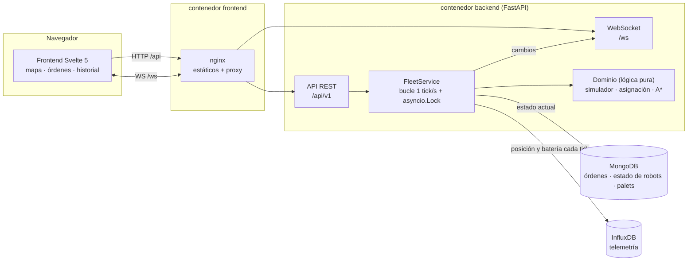

# NEXUS Lite

Mini gestor de flota de robots móviles (AMR). Un backend simula 5 robots en un almacén de 20 × 12 celdas, asigna órdenes de transporte de palets y envía los cambios en tiempo real a un frontend con el mapa de la planta.

Prueba técnica para el puesto de Desarrollador/a Fullstack del equipo NEXUS (AND&OR). Es un ejercicio ficticio: el nombre «NEXUS Lite» y la marca son propios del ejercicio, no un producto de AND&OR.

**Contenido**

1. [Arranque](#1-arranque)
2. [Cómo probarlo](#2-cómo-probarlo)
3. [Tests](#3-tests)
4. [Arquitectura](#4-arquitectura)
5. [Requisitos cubiertos](#5-requisitos-cubiertos)
6. [Contrato de la API](#6-contrato-de-la-api)
7. [Decisiones y alternativas descartadas](#7-decisiones-y-alternativas-descartadas)
8. [Qué he añadido por encima del enunciado](#8-qué-he-añadido-por-encima-del-enunciado)
9. [Qué mejoraría con más tiempo o antes de una planta real](#9-qué-mejoraría-con-más-tiempo-o-antes-de-una-planta-real)
10. [Horas dedicadas y uso de IA](#10-horas-dedicadas-y-uso-de-ia)

---

## 1. Arranque

Requisito: Docker con Docker Compose.

```bash
docker compose up --build
```

No hace falta ningún paso manual: InfluxDB se configura sola en el primer arranque (organización, bucket y token) y el backend espera a que MongoDB e InfluxDB estén sanos antes de arrancar.

| Servicio | URL |
|---|---|
| **Aplicación** | http://localhost:8080 |
| API y documentación OpenAPI | http://localhost:8000/docs |
| InfluxDB (admin / nexus-admin-pass) | http://localhost:8086 |
| MongoDB | mongodb://localhost:27017 (base `nexus_lite`) |

Para empezar de cero (borrar misiones, estado de robots y telemetría):

```bash
docker compose down -v
```

### Ver los datos

**MongoDB** (base `nexus_lite`: colecciones `missions`, `robots` y `stations`). Sin instalar nada, con el proyecto arrancado, se puede levantar el visor web mongo-express:

```bash
docker run --rm -p 8081:8081 -e ME_CONFIG_MONGODB_URL=mongodb://host.docker.internal:27017 mongo-express
```

Después se abre http://localhost:8081 (usuario `admin`, contraseña `pass`). También sirve cualquier cliente de MongoDB, como MongoDB Compass, con la URI `mongodb://localhost:27017`, o la consola:

```bash
docker compose exec mongo mongosh nexus_lite --quiet --eval "db.missions.find().toArray()"
```

Conviene usarlo solo para consultar: si se editan documentos con el backend en marcha, el simulador los sobrescribe en el siguiente tick.

**InfluxDB** (telemetría): http://localhost:8086 → *Data Explorer* → bucket `telemetry` → medida `robot_telemetry` → campo `battery` (o `x`, `y`, `state`) → *Submit*. Por API: http://localhost:8000/api/v1/robots/R1/telemetry (con sesión, ver [autenticación](#autenticación-y-roles)).

## 2. Cómo probarlo

1. Abre http://localhost:8080 e inicia sesión. Hay dos usuarios (también aparecen en la pantalla de login, basta con hacer clic):

   | Usuario / contraseña | Rol | Qué puede hacer |
   |---|---|---|
   | `operador` / `operador` | Operador | Todo: crear, cancelar y reenviar órdenes, declarar y retirar palets, forzar ERROR y rearmar robots |
   | `consulta` / `consulta` | Consulta | Solo ver: planta, órdenes, detalle de robots e historial |

   Arriba a la derecha se ve con qué rol estás actuando y debe aparecer **En vivo**. *Salir* cierra la sesión.
2. **Crear órdenes:** haz clic en una estación de recogida (P1–P4) del mapa, elige destino y prioridad y pulsa *Crear*. También se puede desde el formulario «Nueva misión» de la derecha.
3. **Seguir una orden:** el robot asignado va al origen, carga el palet (3 s), lo lleva al destino y lo descarga (3 s). El palet queda 2 s en el destino con un anillo de cuenta atrás y se retira.
4. **Palets:** un origen sin palet no admite órdenes («No hay nada que mover en la posición P1»). Haz clic en él y pulsa *Declarar palet*. Un palet que ya tiene una orden no admite otra, y un destino con un palet recién entregado está ocupado.
5. **Detalle de robot:** haz clic en un robot (mapa o tarjeta «Flota») para ver su estado, batería, ruta, orden actual y el histórico de batería de los últimos 10 minutos (InfluxDB).
6. **Averías:** en el detalle de un robot, *Forzar ERROR* simula una avería y *Rearmar* lo recupera. Si lleva un palet, la orden queda en pausa y al rearmarlo termina la entrega.
7. **Carga:** crea muchas órdenes seguidas para que bajen las baterías. Los robots van a C1 (2 plazas), esperan en la celda de cola o, si también está ocupada, en un parking, sin coger órdenes mientras esperan.
8. **Historial:** pestaña *Historial*, con filtros (estado, robot, origen, destino, prioridad, fechas, id), paginación, exportación a CSV y reenvío de órdenes fallidas o canceladas.
9. **Reinicio (B-06):** con robots trabajando, ejecuta `docker compose restart backend`. La interfaz muestra *Sin conexión*, se reconecta sola y los robots siguen donde estaban, con su batería y sus órdenes.
10. **Roles:** entra como `consulta`: desaparecen el formulario de órdenes, *Cancelar*, *Reenviar*, los botones del robot y el menú de las estaciones. La API también lo impide (403), no solo la interfaz.
11. **Telemetría:** http://localhost:8000/api/v1/robots/R1/telemetry (requiere sesión; lo más cómodo es desde http://localhost:8000/docs → *Authorize*), o en InfluxDB → *Data Explorer* → bucket `telemetry` → `robot_telemetry` → campo `battery`.

## 3. Tests

**Backend (pytest, 103 tests).** Con Docker, sin instalar nada:

```bash
docker compose run --rm --no-deps backend python -m pytest -q
```

o en local:

```bash
cd backend
pip install -r requirements.txt
python -m pytest -q
```

No necesitan MongoDB ni InfluxDB: usan implementaciones en memoria de los repositorios.

| Fichero | Qué cubre |
|---|---|
| `test_assignment.py` | **B-02**: prioridad, antigüedad, robot más cercano, batería ≥ 30 % y suficiente para terminar, robot concreto en reenvíos |
| `test_simulator.py` | Ciclo completo de una orden (30 ticks exactos), carga de batería y cola de C1, cancelación, validación, batería agotada |
| `test_traffic.py` | Nunca dos robots en la misma celda, prioridad y antigüedad en cruces, ceder el paso. **Test de estrés**: 60 órdenes aleatorias con varias semillas, sin colisiones, sin robots sin batería, sin entrar en casillas con palet y con todas las órdenes terminadas |
| `test_pallets.py` | Palets en origen y destino, reservas, destino ocupado, declarar palet |
| `test_operator.py` | A*, forzar ERROR, rearmar (con y sin palet a bordo, con y sin batería), retirar palet |
| `test_restore.py` | **B-06**: qué pasa con robots, palets y órdenes al reiniciar |
| `test_api.py` | **B-01 / B-07**: endpoints, códigos de error, filtros del historial, WebSocket |
| `test_auth.py` | Login, sesión caducada o falsa (401), rol consulta: puede leer y recibe 403 en cada acción; WebSocket sin sesión rechazado |
| `test_repository.py`, `test_map_config.py` | Consulta a MongoDB de los filtros; validación del mapa |

**Frontend (Vitest, 22 tests).** Necesita Node 22:

```bash
cd frontend
npm install
npm test
```

Cubren la lógica pura (`src/lib/logic.js`: orientación de los robots, ruta, filtros, duración, gráfico de batería) y componentes renderizados en un DOM simulado (indicador de conexión, panel de creación de órdenes según el estado del palet).

## 4. Arquitectura



Versión en texto:

```
Navegador ──HTTP /api, WS /ws──> nginx (:8080) ──> FastAPI (:8000)
                                                   ├─ api.py         REST (B-01, B-07)
                                                   ├─ main.py /ws    tiempo real (B-04)
                                                   ├─ service.py     bucle de 1 s, candado, persistencia
                                                   │    └─ domain/   simulador, asignación, A* (sin dependencias)
                                                   ├─ repository.py  MongoDB: órdenes, robots, palets (B-05, B-06)
                                                   └─ telemetry.py   InfluxDB: posición y batería (B-05)
```

**Ciclo de un tick (1 segundo):**

1. Se retiran los palets entregados cuyo tiempo ha pasado.
2. Robots parados avanzan su temporizador (cargar o descargar mercancía, cargar batería).
3. **Tráfico:** los robots que se mueven avanzan una celda, por turnos de prioridad, siguiendo su ruta A*.
4. **B-03:** robots libres con poca batería, a C1 o a su cola.
5. **B-02:** asignación de órdenes pendientes.
6. Robots libres sin destino, al parking libre más cercano.
7. Se guardan en MongoDB y se envían por WebSocket solo los robots, órdenes y palets que han cambiado.
8. Fuera del candado, se escribe la telemetría de los 5 robots en InfluxDB.

**Estructura del código:**

```
backend/
  config/map.json          mapa y parámetros de simulación (validados al arrancar)
  app/domain/              lógica pura, testeable sin base de datos
    models.py              Robot, Mission y sus estados
    assignment.py          B-02
    simulator.py           tick, carga, palets, tráfico, averías
    pathfinding.py         A*
  app/service.py           une dominio, persistencia y tiempo real
  app/repository.py        MongoDB (y versión en memoria para tests)
  app/telemetry.py         InfluxDB (y versión en memoria para tests)
  app/api.py, schemas.py   contrato REST
  app/auth.py              usuarios, roles y token JWT
  app/realtime.py          difusión por WebSocket
frontend/src/
  lib/fleet.svelte.js      estado compartido, WebSocket y llamadas a la API
  lib/logic.js             lógica pura (testeada)
  components/              mapa, robot, palet, órdenes, historial, gráfico...
```

### El mapa

Definido en `backend/config/map.json`. Si tiene un error (estación fuera de la cuadrícula, dos elementos en la misma celda, falta un tipo de estación, dos robots en la misma celda…), el backend no arranca y lo explica.

| Elemento | Posición |
|---|---|
| P1–P4 (recogida) | (0,1), (0,4), (0,7), (0,10) |
| D1–D2 (entrega) | (19,3), (19,8) |
| C1 (carga, 2 plazas) | plazas en (10,0) y (12,0), celda de cola en (11,0) |
| PK1–PK5 (parkings) | (4,2), (4,9), (8,6), (15,2), (15,9); los robots arrancan en ellos |

## 5. Requisitos cubiertos

| ID | Cómo |
|---|---|
| **B-01** | `POST/GET /missions`, filtro por estado (y más), `POST /missions/{id}/cancel`, `GET /robots` |
| **B-02** | `domain/assignment.py`. Orden: prioridad (1 = máxima) y, a igualdad, la más antigua. Robot: el libre más cercano al origen (Manhattan) con batería ≥ 30 % |
| **B-03** | Robot libre con < 20 % va a C1. C1 llena: el primero espera en la celda de cola y el resto en un parking (ver [decisiones](#carga-y-c1-llena-b-03)) |
| **B-04** | WebSocket `/ws`: «snapshot» al conectar y «update» solo con lo que cambia |
| **B-05** | Órdenes en MongoDB; histórico de posición y batería de cada robot en InfluxDB, un punto por robot y segundo |
| **B-06** | No se pierde ninguna orden; los robots conservan posición y batería (ver [decisiones](#reinicio-b-06)) |
| **B-07** | Validación con pydantic más reglas de negocio; 404, 409, 422 y 503 coherentes (ver [contrato](#6-contrato-de-la-api)) |
| **F-01** | Mapa SVG con estaciones, palets y robots (AMR vistos desde arriba) coloreados por estado y orientados según su dirección |
| **F-02** | Lista de órdenes en vivo, formulario, cancelar y creación desde el mapa |
| **F-03** | Detalle de robot: estado, batería, posición, destino, orden actual e histórico de batería |
| **F-04** | Indicador *En vivo / Conectando / Sin conexión* con cuenta atrás; reconexión automática (1, 2, 4… hasta 10 s) y mapa en gris mientras no hay conexión |
| Docker | `docker compose up` levanta todo sin pasos manuales |
| Tests | Asignación, API y bastante más: 103 en backend y 22 en frontend |
| Contrato | OpenAPI automático en `/docs` y tabla en este README |

**Extras opcionales del enunciado que he hecho:**

- Gráfico del histórico de batería leído de InfluxDB.
- Botón para forzar un robot a ERROR y reasignar su orden.
- Detección de dos robots en la misma celda y política para resolverlo: no se llega a producir.
- Autenticación con dos roles, operador y consulta (ver [Autenticación](#autenticación-y-roles)).

Sé que el enunciado pedía uno o dos como máximo; ver [sección 8](#8-qué-he-añadido-por-encima-del-enunciado).

## 6. Contrato de la API

Documentación interactiva completa (OpenAPI) en http://localhost:8000/docs. Todas las rutas van bajo `/api/v1`. Los errores devuelven `{"detail": "mensaje"}`.

### Autenticación y roles

`POST /api/v1/auth/login` con `{"username": "operador", "password": "operador"}` devuelve `{"token", "username", "role", "display_name"}`. El resto de rutas exige la cabecera `Authorization: Bearer <token>` (en `/docs`, botón *Authorize*) y el WebSocket el parámetro `/ws?token=<token>`.

- **401** sin token, token falso o caducado (8 h). El WebSocket se cierra con código 1008.
- **403** si el rol `VIEWER` (consulta) intenta una acción. Puede hacer todos los `GET` y conectarse al WebSocket.
- Las acciones marcadas con 🔒 en la tabla solo las puede hacer el rol `OPERATOR`.

| Método | Ruta | Qué hace | Errores |
|---|---|---|---|
| POST | `/auth/login` | Inicia sesión (pública) | 401 usuario o contraseña incorrectos |
| GET | `/auth/me` | Usuario y rol de la sesión actual | 401 |
| POST | `/missions` 🔒 | Crea una orden `{origin, destination, priority}` → 201 | 409 origen sin palet, palet ya asignado o destino ocupado · 422 entrada no válida · 503 MongoDB caída |
| GET | `/missions` | Historial, de más reciente a más antigua. Filtros: `state` (uno o varios), `robot_id`, `origin`, `destination`, `priority`, `created_from`, `created_to`, `id_prefix`. Paginación: `limit`, `offset`; el total va en la cabecera `X-Total-Count` | 422 |
| GET | `/missions/{id}` | Una orden | 404 |
| POST | `/missions/{id}/cancel` 🔒 | Cancela una orden PENDING o ASSIGNED | 404 · 409 si está en curso o terminada |
| POST | `/missions/{id}/retry` 🔒 | Reenvía una FAILED o CANCELLED como orden nueva `{robot_id?}` → 201 | 404 · 409 · 422 robot inexistente |
| GET | `/robots` · `/robots/{id}` | Estado de los robots (incluye `path`, la ruta A* restante) | 404 |
| GET | `/robots/{id}/telemetry` | Histórico de InfluxDB (`minutes`, `every`) | 404 · 503 InfluxDB caída |
| POST | `/robots/{id}/error` 🔒 | Fuerza una avería | 404 · 409 si ya está en ERROR |
| POST | `/robots/{id}/reset` 🔒 | Rearma un robot en ERROR | 404 · 409 si no está en ERROR o no hay plaza libre en C1 para cargarlo |
| GET | `/stations` | Palets en orígenes y destinos (`pallet`, `clears_in`, `reserved_by`) | |
| POST | `/stations/{id}/pallet` 🔒 | Declarar palet en un origen → 201 | 404 · 409 ya hay palet · 422 no es un origen |
| DELETE | `/stations/{id}/pallet` 🔒 | Retirar palet de un origen | 404 · 409 no hay palet o tiene una orden · 422 |
| GET | `/map` | Mapa y parámetros de simulación | |
| GET | `/health` (sin `/api/v1`) | Comprobación de vida (pública) | |
| WS | `/ws?token=…` (sin `/api/v1`) | `{"type": "snapshot" \| "update", "robots": [...], "missions": [...], "stations": [...]}` | |

**Criterio de códigos:** 422 cuando la petición está mal formada o no tiene sentido (prioridad 7, origen que no es de recogida); 409 cuando la petición es correcta pero choca con el estado actual (cancelar algo en curso, un origen sin palet, un destino ocupado).

## 7. Decisiones y alternativas descartadas

### Tecnología

| Decisión | Por qué | Descartado |
|---|---|---|
| **Backend en Python + FastAPI** | Es el lenguaje en el que más experiencia tengo en backend: servicios 24/7 en producción en mi trabajo actual. Con el tiempo limitado prefería entregar algo sólido y poder modificarlo con soltura en directo. FastAPI da validación con pydantic, async nativo para el WebSocket y OpenAPI automático | Node.js + TypeScript: es vuestro stack principal y el que más me interesa aprender, pero lo habría hecho más lento y con menos seguridad |
| **Frontend en Svelte 5 (sin SvelteKit)** | El preferido en el enunciado. Una sola página no necesita rutas de servidor ni SSR | SvelteKit: más estructura de la necesaria |
| **WebSocket** | Es lo habitual en gestores de flota y permite, en el futuro, enviar órdenes por el mismo canal | SSE: más sencillo y con reconexión nativa del navegador, pero solo va del servidor al navegador |
| **nginx como proxy de `/api` y `/ws`** | Frontend y backend en el mismo origen: sin CORS y con rutas relativas | Exponer el backend directamente y configurar CORS |

### Simulación

- **El dominio es lógica pura.** `domain/` no conoce FastAPI, MongoDB ni InfluxDB. Por eso se puede testear tick a tick, de forma determinista y sin servicios externos.
- **Un tick por segundo con `asyncio.Lock`.** El bucle del simulador y las peticiones de la API comparten el candado. Así una orden nueva no se cuela a mitad de un tick, y una escritura antigua en MongoDB no puede pisar a una más reciente.
- **Prioridad 1 = máxima,** como una P1 de incidencias.
- **Una orden pasa a IN_PROGRESS cuando el robot llega al origen** y empieza a cargar el palet. Antes de eso está ASSIGNED: se puede cancelar y el robot queda libre.
- **Asignación voraz por prioridad.** Primero la orden más prioritaria elige su robot más cercano, después la siguiente. No busca el óptimo global de todas las parejas, pero respeta la prioridad, que es lo que pide el enunciado. La prioridad se aplica al asignar: una orden urgente no le quita el robot a una que ya ha empezado.
- **Batería al asignar.** Además del ≥ 30 % del enunciado, compruebo que al robot le llega la batería para ir al origen, entregar y volver a C1 con un 5 % de margen. Sin esto, el test de estrés mostraba robots que aceptaban una orden larga con un 30 % y se quedaban sin batería antes de volver a cargar. Un robot libre que no tiene batería para ninguna orden pendiente va a cargar aunque no haya bajado del 20 %, para no quedarse parado con trabajo por hacer.

### Carga y C1 llena (B-03)

- **C1 tiene 2 plazas en celdas distintas,** (10,0) y (12,0), con la celda de cola en medio, en (11,0). Así el robot que espera tiene acceso directo a las dos plazas. Con las plazas juntas y la cola al lado, un robot en cola no podía llegar a la plaza interior si la exterior estaba ocupada.
- **Cola FIFO.** Si hay plaza, el robot va directo a ella. Si no, el primero espera en la celda de cola y el resto en el parking libre que haga más corto el trayecto robot → parking → C1. Si no le llega la batería ni para eso, espera donde está.
- **Mientras esperan, siguen en TO_CHARGER, no en IDLE.** Así nunca se les asigna una orden aunque estén parados en un parking.
- **Al cargar, los robots salen de C1 al 100 %** (`charge_target`, configurable).
- *Descartado:* expulsar de C1 al robot con más batería para dejar sitio. Es más eficiente, pero más difícil de razonar y de testear.

### Tráfico

El enunciado dice «sin obstáculos ni pathfinding», pero con 5 robots en movimiento dos acaban en la misma celda. He tomado como regla que **dos robots nunca comparten celda**:

- **Turnos por prioridad en cada tick.** Primero se mueven los robots con orden (por prioridad de la orden y, a igualdad, la más antigua), luego los que van a cargar y por último los que van al parking.
- **Si dos quieren la misma celda,** entra el más prioritario y el otro se para.
- **Si un robot más prioritario necesita la celda de otro** (de frente, o el otro está parado en su camino), el menos prioritario se aparta a una celda lateral libre: siempre cede el paso. Los robots aparcados también se apartan y después vuelven a su parking.
- **A\* sobre obstáculos fijos.** Cada robot calcula su ruta con A* rodeando lo que no se va a mover pronto: robots en ERROR, robots cargando o descargando, robots en C1 y casillas de entrega con un palet. A igualdad de coste prefiere moverse primero en X y luego en Y, así que sin obstáculos la ruta es la «L» del enunciado.
- **Una casilla de entrega con un palet recién entregado está bloqueada:** el robot que va a descargar ahí espera en la casilla de al lado.
- *Descartado:* A* con reserva de tramos en el tiempo (como un gestor de flota real). Habría sustituido toda la lógica de tráfico, con mucho más riesgo y código difícil de modificar en directo.

### Palets

He modelado la orden como lo que es en planta: mover un palet concreto.

- **Al arrancar, los orígenes tienen un palet.** Después solo se reponen con *Declarar palet*, y se pueden retirar con *Retirar palet*.
- **Una orden solo se crea si** en el origen hay un palet sin otra orden asignada y el destino está libre en ese momento. Si no, devuelve 409 con el motivo.
- **El palet sale del origen cuando el robot termina de cargarlo.** Al entregarlo queda 2 s en el destino (`drop_clear_seconds`) y se retira.
- **Los AMR de AND&OR mueven palets** (series P, F y R). Por eso modelé palets y no estanterías, como en los sistemas Goods-to-Person que conozco.

### Averías

- **Si el robot aún no lleva el palet** (va a recogerlo o lo está cargando), su orden vuelve a PENDING y la coge otro robot: el palet sigue en el origen.
- **Si ya lo lleva a bordo,** la orden queda **en pausa**: sigue IN_PROGRESS y asignada a ese robot. Al rearmarlo termina la entrega. Si no le llega la batería, el operario lo lleva a C1, carga con el palet encima y después entrega.
- **Quedarse sin batería en ruta** se trata igual que una avería.

### Reinicio (B-06)

- **Persistencia.** En MongoDB guardo el **estado actual**: órdenes, robots (posición, batería, estado) y palets de origen. En InfluxDB, el **histórico**. Cada base de datos para lo suyo.
- **Robots:** vuelven a donde estaban, con su batería. Los que estaban en ERROR siguen en ERROR, porque reiniciar el software no arregla un robot. El que cargaba en C1 sigue cargando.
- **Órdenes PENDING y ASSIGNED:** vuelven a PENDING y se reasignan. Como el robot sigue donde estaba, lo normal es que la vuelva a coger él.
- **Órdenes con el palet a bordo:** el robot recupera su orden y la termina, o queda en pausa si estaba en ERROR. Si no se pudo recuperar el estado de ese robot, la orden pasa a FAILED («revisar y reenviar»). Prefiero que una orden falle de forma visible a que el sistema invente dónde está un palet.
- **Robustez:**
  - Una orden se guarda en MongoDB **antes** de responder 201. Si falla, se deshace y se responde 503.
  - Si falla una escritura durante un tick, se reintenta en el siguiente.
  - Si InfluxDB falla, se pierde ese punto de telemetría pero la simulación sigue, y el aviso en el log sale una sola vez.
- *Descartado (primera versión):* que la simulación arrancara de cero en cada reinicio. Los robots volvían al 100 % de batería a su posición inicial, lo que no tiene sentido en una planta.

### Autenticación

- **Token JWT firmado (HS256) en lugar de sesión en servidor:** el backend no guarda estado de sesión, así que un reinicio (B-06) no echa a nadie. El token caduca a las 8 h, un turno.
- **Permisos en el backend, no solo en la interfaz:** cada acción comprueba el rol (`require_operator`). La interfaz oculta los botones al rol consulta para que no vea opciones que no puede usar, pero la seguridad está en la API.
- **Token en `sessionStorage`:** se pierde al cerrar la pestaña. En el WebSocket va como parámetro (`?token=`) porque el navegador no permite cabeceras propias en el handshake.
- **Dos usuarios fijos** configurables por variables de entorno (`OPERATOR_PASSWORD`, `VIEWER_PASSWORD`, `AUTH_SECRET`). Una tabla de usuarios con hash de contraseñas era más de lo que pedía el ejercicio.

### Datos y tiempo real

- **Telemetría en InfluxDB:** el estado del robot va como *field* y no como *tag*, para tener una sola serie por robot en lugar de una por robot y estado. La escritura va fuera del candado y con un tiempo máximo de 2 s, para que una InfluxDB lenta no frene el simulador.
- **El WebSocket notifica dentro del candado,** para que los mensajes salgan en orden. Cada envío tiene un tiempo máximo de 1 s, para que un cliente lento no frene a los demás. Al reconectar llega un snapshot nuevo, así que no hace falta numerar mensajes para recuperar los perdidos.
- **Cancelar** es `POST /missions/{id}/cancel` y no `DELETE`, porque es un cambio de estado: la orden se conserva en el historial.
- **Reenviar** crea una orden nueva enlazada (`retry_of`) en vez de reabrir la original, para no perder la trazabilidad de que falló.

## 8. Qué he añadido por encima del enunciado

El enunciado pide algo pequeño y bien hecho en 6–8 horas. El **núcleo obligatorio** es lo de la [sección 5](#5-requisitos-cubiertos). A partir de ahí seguí añadiendo funcionalidades que creo que un responsable de flota echaría en falta, sabiendo que me salía del alcance:

- Palets reales en origen y destino, con declarar y retirar.
- Tráfico sin colisiones con prioridades, ceder el paso y A*.
- Parkings repartidos por el mapa: el robot libre vuelve al más cercano.
- Cola de carga con espera en parking sin coger órdenes.
- Averías y rearme con la entrega en pausa.
- Persistencia del estado de robots y palets.
- Crear órdenes haciendo clic en el mapa.
- Historial con filtros, CSV y reenvío.
- Cuatro de los extras opcionales.
- Tests de frontend.
- Diseño visual con la paleta de color de AND&OR.

## 9. Qué mejoraría con más tiempo o antes de una planta real

**Antes de llevarlo a una planta:**

- **Robots reales en lugar de simulados:** integración por **VDA 5050** sobre MQTT (`order`, `instantActions`, `state`), para gestionar flotas de varios fabricantes. El simulador pasaría a ser un adaptador más.
- **Reconciliación tras un reinicio con lo que reporta cada robot** (si lleva carga, dónde está), en lugar de fiarse solo del último estado guardado.
- **Un único proceso simulador.** El estado vive en memoria en un proceso: con varias instancias del backend habría que separar el simulador en un proceso único o usar un lock distribuido.
- **Seguridad:** los usuarios están fijos en la configuración y el secreto del token tiene un valor por defecto de desarrollo. En una planta: usuarios en base de datos con contraseñas con hash (o el directorio de la empresa por OIDC), secreto en un gestor de secretos, HTTPS y auditoría de quién ha hecho cada acción (rearmar, retirar palet…).
- **Idempotencia:** `Idempotency-Key` en `POST /missions`, para que un reintento del cliente (por ejemplo, desde un ERP) no cree la orden dos veces.

**Con más tiempo:**

- **Tráfico:** reserva de tramos en el tiempo (A* espacio-temporal) en lugar de esquivar localmente. Escala mejor con más robots y pasillos estrechos.
- **Preempción:** que una orden urgente pueda quitarle el robot a una ya asignada, siempre que no haya recogido el palet.
- **Carga de oportunidad:** un robot libre por debajo del 30 % con una plaza de C1 libre va a cargar aunque no haya órdenes.
- **Tipos de carga** (palet, mesa o estantería) según el modelo de robot.
- **Configuración desde la interfaz:** hoy el mapa y los parámetros están en `map.json`, versionado y validado. Una pantalla de edición sería el siguiente paso, y la dejé fuera a propósito por tiempo y riesgo.
- **Memoria:** purgar del simulador las órdenes terminadas (hoy se quedan en memoria hasta reiniciar).
- **Más tests:** extremo a extremo (Playwright) contra el `docker compose`, y tests de integración contra MongoDB e InfluxDB reales.
- **CI** con lint y tests en cada commit.
- **Opciones** Operaciones sobre los robots desde el sistema, por ejemplo excluir o forzar carga. 
- **Observabilidad:** métricas de la flota (órdenes por hora, tiempo medio, ocupación de C1, tiempo esperando paso) en un cuadro de mando sobre InfluxDB.

## 10. Horas dedicadas y uso de IA

**Horas reales:** He empleado un total 7 hora y media aproximadamente, durante 4 días naturales. Donde he tardado unas 6 horas en desarrollar las funciones obligatorias, 1 hora en las opcionales y poco más de media hora en generar toda la documentación requerida.

**Uso de IA:** He usado un asistente de IA (Claude) durante todo el desarrollo:
- **Cómo lo he usado:** para generar buena parte del código a partir de mis indicaciones, escribir tests, revisar casos límite y redactar documentación.
- **Las decisiones de diseño y de negocio son mías** (las de la sección 7): qué hacer con las órdenes al reiniciar, que un robot esperando carga no pueda coger órdenes, que nunca coincidan dos robots en una celda y quién cede el paso, la lógica de palets, que un robot averiado con un palet termine la entrega al rearmarlo…
- **Errores que detecté al probar** y que se corrigieron:
  - Los robots volvían al 100 % de batería al reiniciar.
  - Un robot podía entrar en una casilla de entrega con un palet.
  - Un robot rearmado perdía el palet que llevaba encima.
- **Revisión:** he probado cada funcionalidad en la interfaz y he revisado el código para poder explicarlo y modificarlo.
